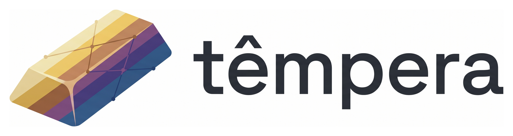
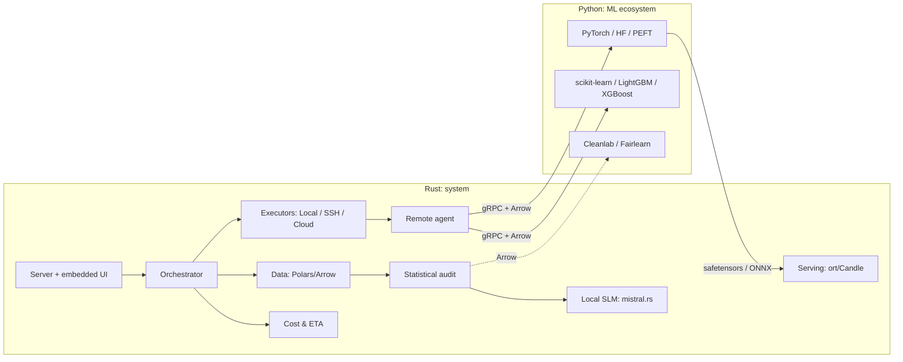

<p align="center">
  
</p>

<p align="center">
  <strong>Train machine learning models the right way, on the cheapest machine that gets the job done.</strong>
</p>

<p align="center">
  <a href="https://github.com/roanbrasil/tempera/actions/workflows/ci.yml"></a>
</p>

> **Why the name?** *Têmpera* is Portuguese for *tempering*: the heat treatment that turns brittle steel into
> reliable steel. The logo is a steel ingot showing the real tempering colors (straw → bronze → purple → blue),
> with a neural network running through it: raw data, tempered into a model you can trust. Built in Rust.

Têmpera is an ML model training platform that takes you from a raw data file to an evaluated, ready-to-use model, without requiring you to be an expert in ML, infrastructure, or GPUs.

- 📥 **In:** your data (CSV, Parquet, images, text) and what you want to predict.
- 🔍 **Audits:** detects data leakage, class imbalance, duplicates, mislabeled data, and bias, with statistics making the call and a local SLM explaining it.
- 🧠 **Chooses:** train from scratch or start from a pretrained model, with a justified recommendation.
- 🖥️ **Runs wherever is cheapest:** your machine, a GPU on your local network via SSH, or a GPU rented in the cloud via API key.
- 📈 **Tracks:** live metrics, ETA, and estimated vs. actual cost.
- 📦 **Delivers:** an evaluated model, a report, and an artifact (ONNX/safetensors) ready to serve.

> Status: **M1 · Local tabular (CLI)**. Ingest → audit → split → train native + Python candidates
> through the local agent → leaderboard → one-time test evaluation → HTML report. Web UI comes in M2.
> See the [Roadmap](docs/wiki/Roadmap.md) and the issues.

## Quick start

Requirements: Rust (see `rust-toolchain.toml`) and, for LightGBM/XGBoost/random forest,
[uv](https://docs.astral.sh/uv/). Without uv the Python candidates are skipped and the native Rust
ones still run.

```bash
cargo build --release
export PATH="$PWD/target/release:$PATH"

cd examples
tempera run churn.yaml        # binary classification, temporal split
tempera run houses.yaml       # regression
tempera runs                  # job history; `tempera runs <job>` for the leaderboard
tempera report                # path of the latest HTML report
```

What a run looks like (with the planted leak *not* dropped, the audit stops it first):

```text
  ● Audit     1 red · 2 yellow · 6 features used · 2 columns dropped
      RED    A1:refund_amount       Probable target leakage · needs a decision
             `refund_amount` alone predicts `churned` with single-feature AUC = 0.993.
  ✗ Training blocked by the audit (policy: block_on_red).
```

After adding `refund_amount` to `data.drop`:

```text
  ● Split     temporal · train 1,918 · valid 480 · test 600 (held out)
  ● Training  6 candidates · ranked by pr_auc on validation
      ✓ majority (builtin)                 pr_auc   0.1917  0.0s
      ✓ logistic_regression (native)       pr_auc   0.5401  0.5s
      ✓ decision_tree (native)             pr_auc   0.3728  0.7s
      ✓ random_forest (python)             pr_auc   0.4614  22.5s
      ✓ lightgbm (python)                  pr_auc   0.4878  11.0s
      ✓ xgboost (python)                   pr_auc   0.4930  12.7s
  ● Winner    logistic_regression · test pr_auc = 0.5698 (evaluated once)
```

On your own data: `tempera init data.csv --target <column>` writes a `tempera.yaml`, then
`tempera audit` and `tempera run`. State lives in `./.tempera` (override with `TEMPERA_HOME`).

---

## Why it exists

| Real problem | How Têmpera solves it |
|---|---|
| "My model scored 99% on the test set and failed in production" | Leakage audit and a correct split (by group/time) before training |
| "Cloud GPUs are expensive and I forget to turn them off" | Cost estimate before running, budget cap, auto-shutdown, spot with checkpointing |
| "I have a gaming PC with an idle GPU" | SSH executor: uses any machine on your network as a worker |
| "I don't know whether to train from scratch or fine-tune" | Recommender with a justification (data size, domain, budget) |
| "My Python/CUDA environment is broken again" | Orchestrator in Rust (single binary) + Python environments provisioned with `uv` |
| "My data is sensitive (LGPD/GDPR)" | Local-first: data and the SLM never leave your infrastructure unless you want them to |

## Core principle: the best of each language



**Contracts between the two worlds:** Apache Arrow (data), safetensors/ONNX (models), gRPC/protobuf (control). Details in [Architecture](docs/wiki/Architecture.md).

## Documentation

The documentation lives in [`docs/wiki`](docs/wiki/Home.md), mirrored to the GitHub wiki.

| Page | Contents |
|---|---|
| [Vision and Problem](docs/wiki/Vision-and-Problem.md) | Personas, pain points, differentiators, what we are **not** |
| [User Journey](docs/wiki/User-Journey.md) | From upload to a ready model, screen by screen |
| [Architecture](docs/wiki/Architecture.md) | Components, Rust × Python split, flows |
| [Data Audit](docs/wiki/Data-Audit.md) | Bias/leakage checks and the role of the SLM |
| [Algorithm Catalog](docs/wiki/Algorithm-Catalog.md) | What is supported, and on which backend |
| [Execution and Machines](docs/wiki/Execution-and-Machines.md) | Local, SSH/LAN, cloud, agent, checkpointing |
| [Cost and Estimation](docs/wiki/Cost-and-Estimation.md) | ETA, memory, cost, savings strategies |
| [Contracts and Specifications](docs/wiki/Contracts.md) | `tempera.yaml`, protobuf, Arrow layout |
| [Security and Privacy](docs/wiki/Security.md) | Secrets, SSH, LGPD/GDPR, isolation |
| [Tech Stack](docs/wiki/Tech-Stack.md) | Chosen crates and libraries, and why |
| [Roadmap](docs/wiki/Roadmap.md) | Milestones M0 to M7 |
| [Decisions (ADRs)](docs/adr/README.md) | Record of architecture decisions |
| [Glossary](docs/wiki/Glossary.md) | Terms used in the project |
| [Contributing](docs/wiki/Contributing.md) | Workflow, standards, how to run |

## Repository layout

```
tempera/
├── crates/
│   ├── tempera-core/     # domain: job spec, backend events, errors
│   ├── tempera-proto/    # generated gRPC types (agent <-> server)
│   ├── tempera-data/     # ingestion, profiling, splits (Polars/Arrow)
│   ├── tempera-audit/    # statistical audit + SLM advisor
│   ├── tempera-exec/     # Executor trait: Local, Ssh, Cloud
│   ├── tempera-agent/    # binary that runs on the worker
│   ├── tempera-cost/     # ETA, memory, price catalog
│   ├── tempera-track/    # metrics, runs, artifacts (SQLite)
│   ├── tempera-native/   # native Rust algorithms (linfa, Burn)
│   ├── tempera-serve/    # inference (ort / Candle)
│   └── tempera-server/   # Axum API + embedded UI + CLI
├── workers/python/       # tempera_worker: PyTorch/HF/sklearn adapters
├── proto/                # gRPC contracts (.proto)
├── schemas/              # JSON Schemas generated from tempera-core
├── examples/             # example tempera.yaml specs
├── ui/                   # SvelteKit (static build embedded in the binary), planned
├── assets/               # logo and icon
└── docs/
```

## License

To be decided (see the licensing issue). **Private** repository for now.
