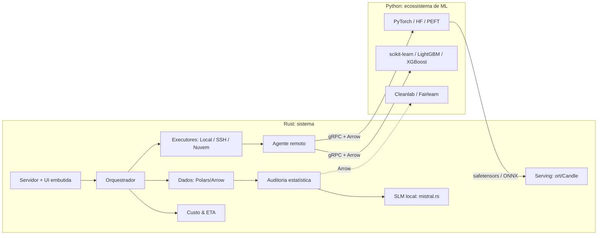

# Têmpera

> **Treine modelos de machine learning do jeito certo, na máquina mais barata que resolve.**

Têmpera é uma plataforma de treino de modelos de ML que leva você do arquivo de dados bruto até um modelo avaliado e pronto para uso, sem exigir que você seja especialista em ML, em infraestrutura ou em GPU.

- 📥 **Entra:** seus dados (CSV, Parquet, imagens, texto) e o que você quer prever.
- 🔍 **Audita:** detecta vazamento de dados, desbalanceamento, duplicatas, rótulos errados e viés, com estatística decidindo e um SLM local explicando.
- 🧠 **Escolhe:** treinar do zero ou partir de um modelo pré-treinado, com recomendação justificada.
- 🖥️ **Roda onde for mais barato:** sua máquina, uma GPU na sua rede local via SSH ou uma GPU alugada na nuvem por API key.
- 📈 **Acompanha:** métricas ao vivo, ETA e custo estimado vs. real.
- 📦 **Entrega:** modelo avaliado, relatório e artefato (ONNX/safetensors) para servir.

> Status: **fase de especificação**. Veja o [Roadmap](docs/wiki/Roadmap.md) e as issues.

---

## Por que existe

| Problema real | Como o Têmpera resolve |
|---|---|
| "Meu modelo deu 99% no teste e falhou em produção" | Auditoria de vazamento e split correto (por grupo/tempo) antes de treinar |
| "GPU na nuvem é cara e eu esqueço ligada" | Estimativa de custo antes de rodar, teto de orçamento, auto-desligamento, spot com checkpoint |
| "Tenho um PC gamer com GPU parado" | Executor SSH: usa qualquer máquina da sua rede como worker |
| "Não sei se treino do zero ou faço fine-tuning" | Recomendador com justificativa (tamanho dos dados, domínio, orçamento) |
| "Ambiente Python/CUDA quebrado de novo" | Orquestrador em Rust (binário único) + ambientes Python provisionados com `uv` |
| "Meus dados são sensíveis (LGPD)" | Local-first: dados e SLM nunca saem da sua infraestrutura se você não quiser |

## Princípio central: o melhor de cada linguagem



**Contratos entre os mundos:** Apache Arrow (dados), safetensors/ONNX (modelos), gRPC/protobuf (controle). Detalhes em [Arquitetura](docs/wiki/Arquitetura.md).

## Documentação

A documentação vive em [`docs/wiki`](docs/wiki/Home.md), espelhada na wiki do GitHub.

| Página | Conteúdo |
|---|---|
| [Visão e Problema](docs/wiki/Visao-e-Problema.md) | Personas, dores, diferenciais, o que **não** somos |
| [Jornada do Usuário](docs/wiki/Jornada-do-Usuario.md) | Do upload ao modelo pronto, tela por tela |
| [Arquitetura](docs/wiki/Arquitetura.md) | Componentes, divisão Rust × Python, fluxos |
| [Auditoria de Dados](docs/wiki/Auditoria-de-Dados.md) | Checagens de viés/vazamento e o papel do SLM |
| [Catálogo de Algoritmos](docs/wiki/Catalogo-de-Algoritmos.md) | O que é suportado, em qual backend |
| [Execução e Máquinas](docs/wiki/Execucao-e-Maquinas.md) | Local, SSH/LAN, nuvem, agente, checkpoint |
| [Custo e Estimativa](docs/wiki/Custo-e-Estimativa.md) | ETA, memória, custo, estratégias de economia |
| [Contratos e Especificações](docs/wiki/Contratos.md) | `tempera.yaml`, protobuf, layout Arrow |
| [Segurança e Privacidade](docs/wiki/Seguranca.md) | Segredos, SSH, LGPD, isolamento |
| [Stack Tecnológica](docs/wiki/Stack-Tecnologica.md) | Crates e bibliotecas escolhidas, e por quê |
| [Roadmap](docs/wiki/Roadmap.md) | Milestones M0 a M7 |
| [Decisões (ADRs)](docs/adr/README.md) | Registro das decisões de arquitetura |
| [Glossário](docs/wiki/Glossario.md) | Termos usados no projeto |
| [Contribuindo](docs/wiki/Contribuindo.md) | Fluxo de trabalho, padrões, como rodar |

## Layout planejado do repositório

```
tempera/
├── crates/
│   ├── tempera-core/     # domínio: Dataset, Job, Run, Spec, erros
│   ├── tempera-data/     # ingestão, profiling, splits (Polars/Arrow)
│   ├── tempera-audit/    # auditoria estatística + conselheiro SLM
│   ├── tempera-exec/     # trait Executor: Local, Ssh, Cloud
│   ├── tempera-agent/    # binário que roda no worker
│   ├── tempera-cost/     # ETA, memória, catálogo de preços
│   ├── tempera-track/    # métricas, runs, artefatos (SQLite)
│   ├── tempera-native/   # algoritmos nativos Rust (linfa, Burn)
│   ├── tempera-serve/    # inferência (ort / Candle)
│   └── tempera-server/   # API Axum + UI embutida + CLI
├── workers/python/       # tempera_worker: adaptadores PyTorch/HF/sklearn
├── proto/                # contratos gRPC
├── ui/                   # SvelteKit (build estático embutido no binário)
└── docs/
```

## Licença

A definir (ver issue de licenciamento). Repositório **privado** por enquanto.
