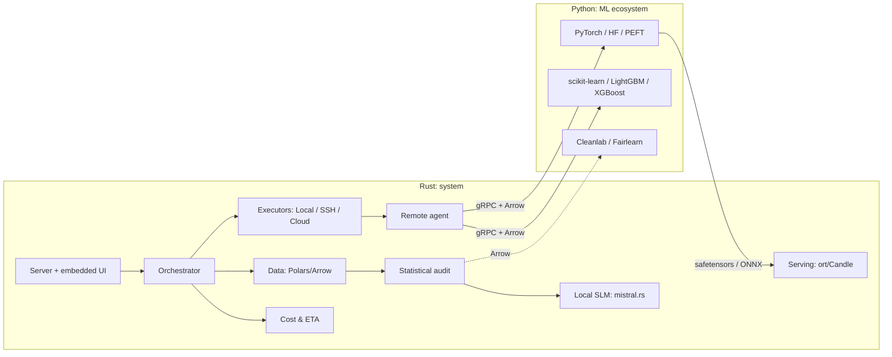

# Têmpera

> **Train machine learning models the right way, on the cheapest machine that gets the job done.**

Têmpera is an ML model training platform that takes you from a raw data file to an evaluated, ready-to-use model, without requiring you to be an expert in ML, infrastructure, or GPUs.

- 📥 **In:** your data (CSV, Parquet, images, text) and what you want to predict.
- 🔍 **Audits:** detects data leakage, class imbalance, duplicates, mislabeled data, and bias, with statistics making the call and a local SLM explaining it.
- 🧠 **Chooses:** train from scratch or start from a pretrained model, with a justified recommendation.
- 🖥️ **Runs wherever is cheapest:** your machine, a GPU on your local network via SSH, or a GPU rented in the cloud via API key.
- 📈 **Tracks:** live metrics, ETA, and estimated vs. actual cost.
- 📦 **Delivers:** an evaluated model, a report, and an artifact (ONNX/safetensors) ready to serve.

> Status: **specification phase**. See the [Roadmap](docs/wiki/Roadmap.md) and the issues.

---

## Why it exists

| Real problem | How Têmpera solves it |
|---|---|
| "My model scored 99% on the test set and failed in production" | Leakage audit and a correct split (by group/time) before training |
| "Cloud GPUs are expensive and I forget to turn them off" | Cost estimate before running, budget cap, auto-shutdown, spot with checkpointing |
| "I have a gaming PC with an idle GPU" | SSH executor: uses any machine on your network as a worker |
| "I don't know whether to train from scratch or fine-tune" | Recommender with a justification (data size, domain, budget) |
| "My Python/CUDA environment is broken again" | Orchestrator in Rust (single binary) + Python environments provisioned with `uv` |
| "My data is sensitive (LGPD/GDPR)" | Local-first: data and the SLM never leave your infrastructure unless you want them to |

## Core principle: the best of each language



**Contracts between the two worlds:** Apache Arrow (data), safetensors/ONNX (models), gRPC/protobuf (control). Details in [Architecture](docs/wiki/Architecture.md).

## Documentation

The documentation lives in [`docs/wiki`](docs/wiki/Home.md), mirrored to the GitHub wiki.

| Page | Contents |
|---|---|
| [Vision and Problem](docs/wiki/Vision-and-Problem.md) | Personas, pain points, differentiators, what we are **not** |
| [User Journey](docs/wiki/User-Journey.md) | From upload to a ready model, screen by screen |
| [Architecture](docs/wiki/Architecture.md) | Components, Rust × Python split, flows |
| [Data Audit](docs/wiki/Data-Audit.md) | Bias/leakage checks and the role of the SLM |
| [Algorithm Catalog](docs/wiki/Algorithm-Catalog.md) | What is supported, and on which backend |
| [Execution and Machines](docs/wiki/Execution-and-Machines.md) | Local, SSH/LAN, cloud, agent, checkpointing |
| [Cost and Estimation](docs/wiki/Cost-and-Estimation.md) | ETA, memory, cost, savings strategies |
| [Contracts and Specifications](docs/wiki/Contracts.md) | `tempera.yaml`, protobuf, Arrow layout |
| [Security and Privacy](docs/wiki/Security.md) | Secrets, SSH, LGPD/GDPR, isolation |
| [Tech Stack](docs/wiki/Tech-Stack.md) | Chosen crates and libraries, and why |
| [Roadmap](docs/wiki/Roadmap.md) | Milestones M0 to M7 |
| [Decisions (ADRs)](docs/adr/README.md) | Record of architecture decisions |
| [Glossary](docs/wiki/Glossary.md) | Terms used in the project |
| [Contributing](docs/wiki/Contributing.md) | Workflow, standards, how to run |

## Planned repository layout

```
tempera/
├── crates/
│   ├── tempera-core/     # domain: Dataset, Job, Run, Spec, errors
│   ├── tempera-data/     # ingestion, profiling, splits (Polars/Arrow)
│   ├── tempera-audit/    # statistical audit + SLM advisor
│   ├── tempera-exec/     # Executor trait: Local, Ssh, Cloud
│   ├── tempera-agent/    # binary that runs on the worker
│   ├── tempera-cost/     # ETA, memory, price catalog
│   ├── tempera-track/    # metrics, runs, artifacts (SQLite)
│   ├── tempera-native/   # native Rust algorithms (linfa, Burn)
│   ├── tempera-serve/    # inference (ort / Candle)
│   └── tempera-server/   # Axum API + embedded UI + CLI
├── workers/python/       # tempera_worker: PyTorch/HF/sklearn adapters
├── proto/                # gRPC contracts
├── ui/                   # SvelteKit (static build embedded in the binary)
└── docs/
```

## License

To be decided (see the licensing issue). **Private** repository for now.
