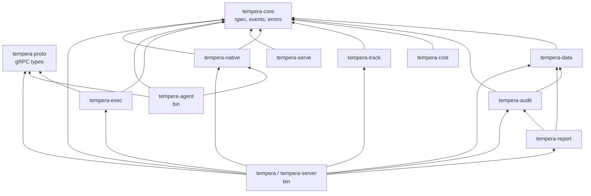

# Crates

Arrows show the dependencies (`A --> B` means A depends on B). `tempera-core` is the base and depends
on no other workspace crate.

| Crate | Status (M1) |
|---|---|
| `tempera-core` | ✅ `tempera.yaml` types + validation, JSONL events, metrics, schema generation |
| `tempera-proto` | ✅ gRPC protocol v1 (compiled with protox, no `protoc` needed) |
| `tempera-data` | ✅ ingestion (CSV/Parquet/JSONL, streaming), profiling, task inference, splits, evaluation |
| `tempera-audit` | ✅ A1 leakage, A2 duplicates, A3/A4 split guards, A5 imbalance, A10 unusable columns, feature plan |
| `tempera-native` | ✅ linfa backend: linear, ridge, logistic, decision tree |
| `tempera-exec` | ✅ agent hub (gRPC) + local executor |
| `tempera-agent` | ✅ runs native/Python backends as subprocesses, streams events |
| `tempera-track` | ✅ SQLite: jobs, runs, metrics, artifacts, one-time test access |
| `tempera-report` | ✅ self-contained HTML report |
| `tempera-server` (bin `tempera`) | ✅ CLI + orchestrator; HTTP API and UI in M2 |
| `tempera-cost`, `tempera-serve` | ⬜ planned (M5–M7) |
