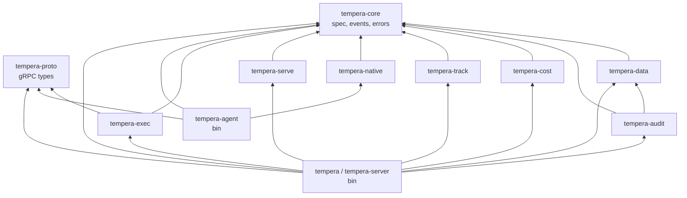

# Crates

Arrows show the **planned** dependencies (`A --> B` means A depends on B). `tempera-core` is the base and
depends on no other workspace crate. Today only `core` and `proto` have real code; the others are
placeholders with their responsibility documented in `src/lib.rs`.

| Crate | Status |
|---|---|
| `tempera-core` | ✅ `tempera.yaml` types + validation, JSONL events, schema generation |
| `tempera-proto` | ✅ gRPC protocol v1 (compiled with protox, no `protoc` needed) |
| `tempera-server` (bin `tempera`) | 🟡 `tempera validate`, `tempera schema` |
| `tempera-agent` | 🟡 skeleton |
| others | ⬜ planned (see milestones) |
