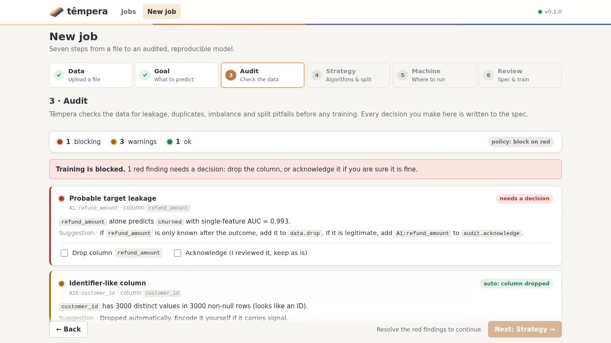
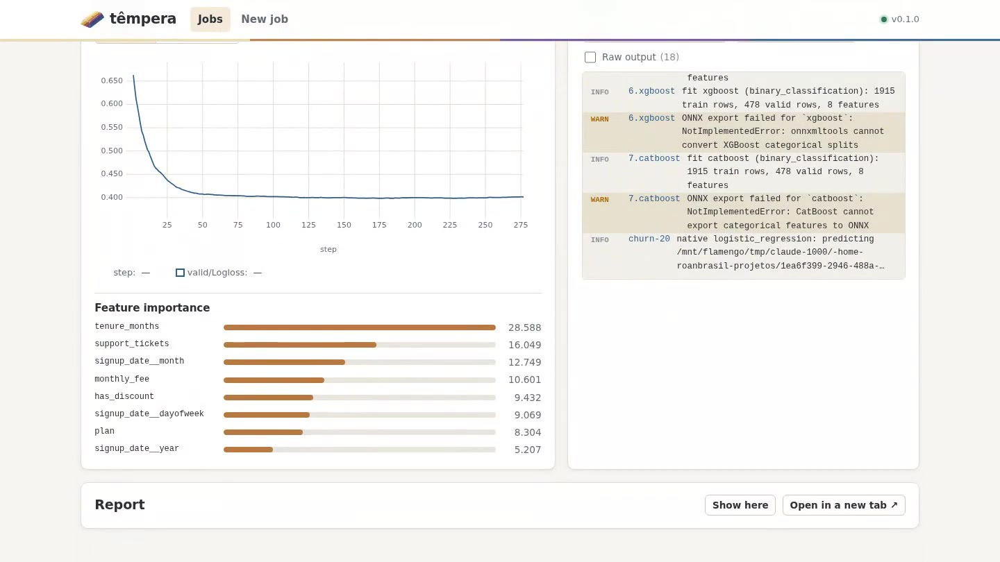

# Uma coluna, AUC de 0,99, e o modelo estava errado: por que treinar ML direito é problema de sistema


*Construí o Têmpera, uma plataforma que audita os dados antes de treinar e roda na máquina mais barata que resolve. Rust no sistema, Python no ecossistema de ML.*

Um dataset de churn, uma coluna chamada `refund_amount` e um AUC de 0,993 com essa coluna sozinha. Quem já treinou modelo de churn sabe o fim da história: o reembolso só existe *depois* que o cliente cancelou. O modelo não aprendeu a prever churn, aprendeu a ler o futuro. No notebook fica lindo; em produção, a coluna chega vazia e o modelo desaba.

Esse erro não é falta de conhecimento. Todo cientista de dados sabe o que é leakage. O erro acontece porque nada no fluxo de trabalho impede que ele aconteça. E foi isso que me fez parar de tratar "treinar do jeito certo" como disciplina pessoal e começar a tratar como problema de engenharia de sistemas.


## Disciplina não escala, guarda-corpo escala

As regras de um treino honesto cabem num cartão: separe o teste antes de tudo e olhe para ele uma única vez; não deixe a mesma entidade cair em treino e teste; desconfie de feature boa demais; compare sempre com um baseline burro. O problema é que cada regra depende de alguém lembrar dela às duas da manhã, com prazo.

No Têmpera essas regras viraram estado do sistema, não conselho:

- O split acontece antes do treino, na ordem temporal > grupo > estratificado > aleatório, conforme os dados permitem.
- O test set é reservado e só pode ser usado **uma vez**. Isso é registrado no SQLite; uma segunda leitura é recusada, não "desaconselhada".
- Uma auditoria com 13 checagens roda antes de qualquer treino: leakage por feature isolada, duplicatas, entidade repetida entre partições, desbalanceamento, drift entre treino e teste (PSI e AUC adversarial), rótulos suspeitos via cleanlab, fairness via fairlearn, proxies de atributo sensível, PII (incluindo CPF e CNPJ com dígito verificador), amostra pequena e missing informativo.
- Achado vermelho bloqueia o treino. Você decide: descarta a coluna ou aceita explicitamente, e a decisão fica registrada no `tempera.yaml`.

Com o `refund_amount` lá, a saída é esta:

```text
  ● Audit     1 red · 2 yellow · 6 features used · 2 columns dropped
      RED    A1:refund_amount       Probable target leakage · needs a decision
             `refund_amount` alone predicts `churned` with single-feature AUC = 0.993.
  ✗ Training blocked by the audit (policy: block_on_red).
```

Na interface web, o mesmo bloqueio aparece com a evidência e a sugestão, e a decisão é um clique:



Para saber se a auditoria funciona de verdade, montei um benchmark com um problema plantado por checagem. Resultado: 13 de 13 encontrados, e zero achados num dataset limpo. Esse segundo número importa tanto quanto o primeiro. Auditoria que grita para tudo vira ruído, e ruído a gente aprende a ignorar.

## Onde entra o SLM (e onde ele não entra)

Estatística sabe dizer que `refund_amount` prevê o alvo bem demais. Não sabe dizer *por quê*. Para isso coloquei um SLM local, o Qwen3 4B rodando no Ollama da minha própria máquina, lendo nomes de coluna, tipos e estatísticas resumidas.

Por conta própria, só com o que leu do schema, ele classificou `refund_amount` como informação pós-evento, com confiança de 0,99. Os dois chegaram à mesma conclusão por caminhos independentes, e é essa concordância que dá confiança.

A regra de arquitetura, porém, é rígida: **a estatística decide, o SLM sugere**. O advisor nunca bloqueia treino, nunca altera dados e, por padrão, se recusa a falar com um endpoint que não seja local. Se você tem dado de saúde ou financeiro, nada sai da sua máquina. Um modelo de 4B quantizado alucina de vez em quando; deixar ele bloquear pipeline seria trocar um problema por outro.

## Por que Rust no sistema e Python no ML


A primeira pergunta que eu mesmo me fiz foi "por que não fazer tudo em Rust?". Eu quis. Só que o ecossistema de ML em Rust ainda não tem LightGBM, XGBoost, CatBoost, cleanlab e fairlearn no nível do Python, e reescrever isso seria anos de trabalho para ficar pior.

A divisão ficou assim:

| Rust | Python |
|---|---|
| CLI, servidor web com a UI embutida, orquestração | sklearn, LightGBM, XGBoost, CatBoost |
| Ingestão, profiling, split, auditoria (Polars) | cleanlab, fairlearn |
| Métricas finais, tracking (SQLite), relatório | ONNX export |
| Agente remoto via gRPC, execução por SSH | |

A fronteira entre os dois é um processo separado, não FFI. O Rust escreve Parquet e um manifesto JSON, sobe o worker Python e lê eventos em JSONL pelo stdout. Se o Python cai, o sistema não cai junto: o run falha com o stderr anexado e o resto do job segue.

E as métricas são calculadas no Rust, a partir das predições que o worker devolve. Assim um modelo LightGBM e um modelo nativo são medidos pelo mesmo código, sem chance de cada biblioteca calcular o PR-AUC do seu jeito.

Rust também não é só gosto pessoal. O profiling de um dataset grande chegou a consumir 6,8 GB de RAM na primeira versão. Com agregação em streaming do Polars e amostragem, ele hoje roda dentro de um cgroup limitado a 2 GB. Para quem quer treinar num notebook comum, essa é a diferença entre funcionar e travar a máquina.

## Quando o resultado bom era o bug

Uma história que me deixou mais humilde. Gerei um exemplo de detecção de fraude e o primeiro resultado foi PR-AUC 1,0. Perfeito. Perfeito demais: os dados sintéticos estavam separáveis, as fraudes eram óbvias. Reescrevi o gerador para que 40% das fraudes imitassem transações normais, como acontece na vida real. Agora o Isolation Forest dá PR-AUC 0,77 no teste, contra 1,5% de taxa base. É um número menos bonito e muito mais útil.

O ponto é o mesmo do `refund_amount`: métrica perfeita é sintoma, não conquista. A ferramenta precisa te empurrar para desconfiar dela.

## A máquina mais barata que resolve


Metade da conta de ML é infraestrutura mal escolhida: GPU alugada para um problema tabular que roda em CPU, ou uma busca de hiperparâmetros que treina tudo até o fim.

O que já funciona hoje:

- **22 algoritmos + 2 baselines** (maioria e média): supervisionados, clustering e detecção de anomalia. `candidates: [all]` roda todos os que fazem sentido para a tarefa, e todo mundo precisa vencer o baseline.
- **Successive halving** na busca de hiperparâmetros: os candidatos treinam com 1/9 dos dados, os melhores sobem para 1/3, só os finalistas veem tudo. Gastou cerca de 36% do compute de uma busca aleatória completa. Minha meta era 30% e ainda não cheguei lá. A configuração padrão de cada algoritmo é sempre o trial 1 e nunca é eliminada, então a busca não consegue piorar o resultado.
- **Qualquer máquina vira worker via SSH.** `tempera machines add gpu-box --host 192.168.0.42`, e o agente é instalado sozinho. Os dados vão uma vez só para um cache por hash. Rodei o mesmo job local e via SSH (nos testes, contra um container com sshd fazendo papel de máquina remota): scores idênticos.

```bash
tempera machines add gpu-box --host 192.168.0.42 --user ana
tempera machines check gpu-box
tempera run churn.yaml   # com compute: { allow: [gpu-box] } no spec
```

## O vídeo: tudo isso rodando

Gravei a demonstração completa, do terminal à interface web, com o exemplo de churn: a auditoria bloqueando, a coluna descartada, sete candidatos treinando e o relatório no fim.

https://youtu.be/O7OKunr6iPE

Um detalhe que aparece no vídeo e vale repetir: quem venceu foi uma regressão logística, não o CatBoost nem o XGBoost. Rodar o baseline e os modelos simples primeiro existe exatamente para isso.



## O que ainda não está pronto

Prefiro dizer antes que alguém descubra:

- **GPU barata na nuvem (M6)** está em preview. Já existem os clientes de RunPod e Vast.ai, o catálogo de preços, a estimativa de custo por máquina, o teto de orçamento que recusa o job antes de alugar e um reaper que derruba instâncias órfãs. Mas os clientes foram escritos a partir da documentação pública das APIs e ainda não rodaram contra uma conta real, e a estimativa de custo ainda não foi calibrada.
- **Deep learning (M5)**, com visão, NLP e fine-tuning com LoRA, também não começou. Hoje o Têmpera é forte em dados tabulares.
- O painel de treino ao vivo ainda não mostra uso de GPU nem alertas de overfitting.

## Experimente e me conte onde quebrou

O código está em [github.com/roanbrasil/tempera](https://github.com/roanbrasil/tempera), e a primeira versão, a v0.1.0, tem binários prontos para Linux e macOS na página de [releases](https://github.com/roanbrasil/tempera/releases). Baixe, rode `tempera run churn.yaml` na pasta `examples` e veja a auditoria parar o treino antes de você. Depois tente com os seus dados. Se ela deixar passar um leakage que você encontrou na mão, abra uma issue: é exatamente o tipo de caso que quero no benchmark.
