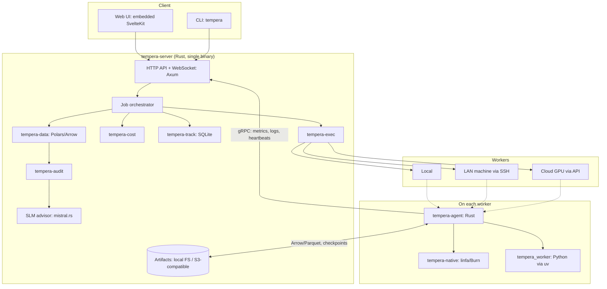
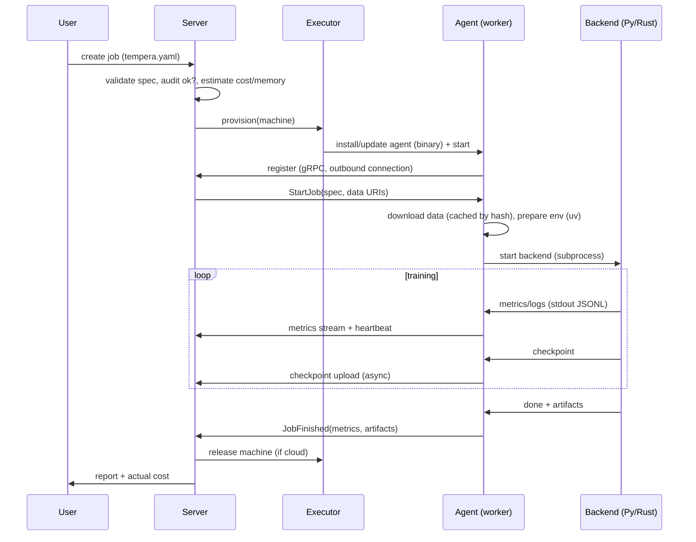

# Architecture

> **Status.** The diagram and the component table describe the target design. Components marked
> ⏳ do not exist yet: `tempera-cost` and `tempera-serve` are empty crates, artifacts are stored on
> the local file system only (no S3), live events use Server-Sent Events/WebSocket per job, and
> the SLM advisor calls an external OpenAI-compatible endpoint (Ollama, llama.cpp; ADR 0008), not
> an embedded mistral.rs. Security controls and their status: [Security](Security.md).

## Overview

## Components

| Component | Language | Responsibility |
|---|---|---|
| `tempera-core` | Rust | Domain types (`Dataset`, `Task`, `JobSpec`, `Run`, `Machine`), errors, IDs |
| `tempera-data` | Rust | Ingestion, conversion to Parquet, profiling, type inference, splits, content hashing |
| `tempera-audit` | Rust (+ optional Python) | Statistical checks; calls Cleanlab/Fairlearn via the worker when needed |
| SLM advisor | Rust client → local OpenAI-compatible endpoint (ADR 0008) | Semantic column analysis, explanations, suggestions as structured JSON |
| `tempera-cost` | Rust | ⏳ empty crate. Today estimation and the price catalog live in `tempera-cloud` (`estimate.rs`, `catalog.rs`) |
| `tempera-exec` | Rust | `Executor` trait with Local, SSH, and per-cloud-provider implementations |
| `tempera-agent` | Rust | Runs on the worker: prepares the environment, runs the backend, streams metrics, checkpoints, and heartbeats |
| `tempera-native` | Rust | Native algorithms (linfa, Burn) for jobs that don't need Python |
| `tempera_worker` | Python | Adapters for sklearn, LightGBM, XGBoost, PyTorch, HF Transformers, PEFT/Unsloth, Cleanlab, Fairlearn |
| `tempera-track` | Rust | Persistence of runs, metrics (time series), artifacts, lineage |
| `tempera-serve` | Rust | ⏳ empty crate (#59): inference from ONNX or safetensors |
| `tempera-server` | Rust | Axum API, WebSocket, embedded UI (rust-embed), CLI (clap) |
| `ui/` | TypeScript | SvelteKit compiled as static output and embedded in the binary |

## Rust × Python split

Rule (see [ADR-0001](../adr/0001-hybrid-rust-python.md)):

- **Rust:** everything that is **system**: concurrency, networking, long-running processes, data I/O, deployment, distributable binary.
- **Python:** everything that depends on the **model ecosystem**: deep learning training, mature classical ML, fairness and label quality libraries.
- **Native Rust for training** when the job is small or tabular and the native backend is good enough. This avoids provisioning Python, starts in under 1 s, and serves as a fallback.

## Contracts

| Boundary | Format | Why |
|---|---|---|
| Data | **Apache Arrow / Parquet** | Zero-copy between Polars, PyArrow, and PyTorch. Columnar and compact. |
| Models | **safetensors**, **ONNX** | Safe (no pickle), servable from Rust |
| Control | **gRPC (tonic ↔ grpcio)** | Bidirectional streaming, versioned schema |
| Specification | **`tempera.yaml`** | Reproducible and versionable in git |

See [Contracts and Specifications](Contracts.md).

## Job flow

## Key design decisions

1. **Process boundary, not FFI.** The Python backend runs as a subprocess of the agent. If it crashes, the agent survives and reports it. PyO3 is restricted to performance extensions ([ADR-0003](../adr/0003-process-boundary.md)).
2. **The agent initiates the connection.** Workers behind NAT or a firewall work; in the SSH case, SSH's own port forwarding is used ([Execution](Execution-and-Machines.md)).
3. **The server is the source of truth.** The agent is *stateless*, except for the data cache and local checkpoints.
4. **Idempotency by hash.** The dataset and the Python environment are cached by content hash and lockfile hash, so re-running is cheap.
5. **Single-user first, multi-user later.** SQLite and local FS at the start; Postgres and S3 behind a trait to scale ([ADR-0005](../adr/0005-persistence.md)).
6. **The test set is touched only once.** Model selection and HPO use only train and validation, and the system enforces this.

## Deployment modes

| Mode | For whom | How |
|---|---|---|
| **Desktop/local** | Ana, Diego | `tempera up` → opens the browser at `localhost` |
| **Team server** | Bruno, Carla | `tempera-server` on a VM or a home server, with auth and workers via SSH/cloud |
| **Managed** (future) | Those who don't want to operate anything | SaaS with its own workers or the customer's (BYO-GPU) |
