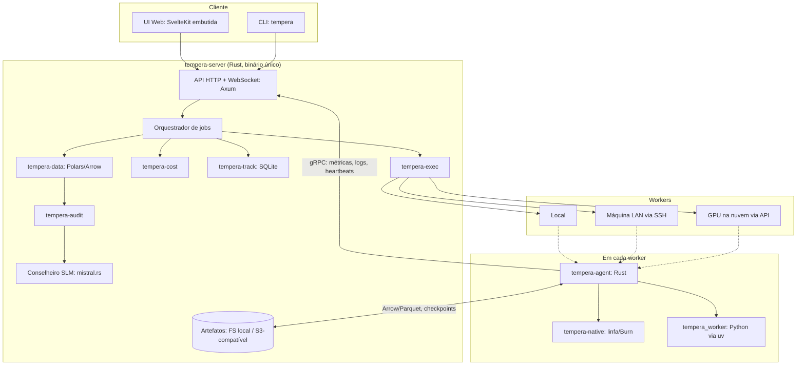
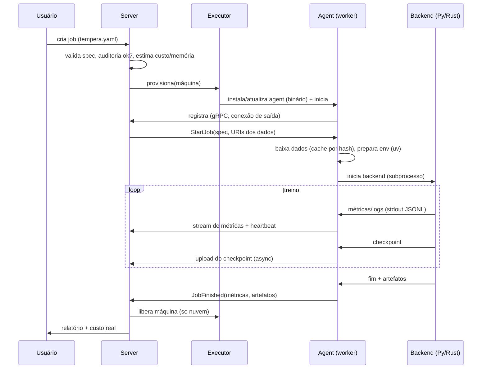

# Arquitetura

## Visão geral

## Componentes

| Componente | Linguagem | Responsabilidade |
|---|---|---|
| `tempera-core` | Rust | Tipos de domínio (`Dataset`, `Task`, `JobSpec`, `Run`, `Machine`), erros, IDs |
| `tempera-data` | Rust | Ingestão, conversão para Parquet, profiling, inferência de tipos, splits, hash de conteúdo |
| `tempera-audit` | Rust (+ Python opcional) | Checagens estatísticas; chama Cleanlab/Fairlearn via worker quando preciso |
| Conselheiro SLM | Rust (mistral.rs) | Análise semântica de colunas, explicações, sugestões em JSON estruturado |
| `tempera-cost` | Rust | Estimativa de memória/FLOPs/ETA, catálogo de preços, recomendação de máquina |
| `tempera-exec` | Rust | Trait `Executor` com implementações Local, SSH e por provedor de nuvem |
| `tempera-agent` | Rust | Roda no worker: prepara o ambiente, executa o backend, faz streaming de métricas, checkpoint e heartbeat |
| `tempera-native` | Rust | Algoritmos nativos (linfa, Burn) para jobs que não precisam de Python |
| `tempera_worker` | Python | Adaptadores para sklearn, LightGBM, XGBoost, PyTorch, HF Transformers, PEFT/Unsloth, Cleanlab, Fairlearn |
| `tempera-track` | Rust | Persistência de runs, métricas (séries temporais), artefatos, linhagem |
| `tempera-serve` | Rust | Inferência a partir de ONNX (ort) ou safetensors (Candle) |
| `tempera-server` | Rust | API Axum, WebSocket, UI embutida (rust-embed), CLI (clap) |
| `ui/` | TypeScript | SvelteKit compilado como estático e embutido no binário |

## Divisão Rust × Python

Regra (ver [ADR-0001](../adr/0001-hibrido-rust-python.md)):

- **Rust:** tudo que é **sistema**: concorrência, rede, processos de longa duração, I/O de dados, deploy, binário distribuível.
- **Python:** tudo que depende do **ecossistema de modelos**: treino deep, ML clássico maduro, bibliotecas de fairness e qualidade de rótulo.
- **Rust nativo para treino** quando o job é pequeno ou tabular e o backend nativo é bom o bastante. Isso evita provisionar Python, sobe em menos de 1 s e serve como fallback.

## Contratos

| Fronteira | Formato | Por quê |
|---|---|---|
| Dados | **Apache Arrow / Parquet** | Zero-copy entre Polars, PyArrow e PyTorch. Colunar e compacto. |
| Modelos | **safetensors**, **ONNX** | Seguro (sem pickle), servível em Rust |
| Controle | **gRPC (tonic ↔ grpcio)** | Streaming bidirecional, schema versionado |
| Especificação | **`tempera.yaml`** | Reprodutível e versionável no git |

Ver [Contratos e Especificações](Contratos.md).

## Fluxo de um job

## Decisões de design importantes

1. **Fronteira de processo, não FFI.** O backend Python roda como subprocesso do agente. Se cair, o agente sobrevive e reporta. O uso de PyO3 fica restrito a extensões de desempenho ([ADR-0003](../adr/0003-fronteira-de-processo.md)).
2. **O agente inicia a conexão.** Workers atrás de NAT ou firewall funcionam; no caso SSH, usa-se um port-forward do próprio SSH ([Execução](Execucao-e-Maquinas.md)).
3. **O servidor é a fonte da verdade.** O agente é *stateless*, exceto pelo cache de dados e checkpoints locais.
4. **Idempotência por hash.** Dataset e ambiente Python são cacheados por hash de conteúdo e de lockfile, então rodar de novo é barato.
5. **Single-user primeiro, multi-user depois.** SQLite e FS local no início; Postgres e S3 atrás de uma trait para escalar ([ADR-0005](../adr/0005-persistencia.md)).
6. **O conjunto de teste é tocado uma única vez.** Seleção de modelo e HPO usam só treino e validação, e o sistema impõe isso.

## Modos de implantação

| Modo | Para quem | Como |
|---|---|---|
| **Desktop/local** | Ana, Diego | `tempera up` → abre o navegador em `localhost` |
| **Servidor de time** | Bruno, Carla | `tempera-server` em uma VM ou no home server, com auth e workers via SSH/nuvem |
| **Gerenciado** (futuro) | Quem não quer operar nada | SaaS com workers próprios ou do cliente (BYO-GPU) |
