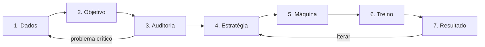

# Jornada do Usuário

Fluxo guiado em 7 etapas. Cada etapa também existe na CLI (`tempera <comando>`) e como campo no `tempera.yaml` (ver [Contratos](Contratos.md)), para quem prefere código.

## 1. Dados

- Upload ou caminho: CSV, Parquet, JSONL, pasta de imagens (`classe/arquivo.jpg`), pasta de texto, ou conexão (Postgres, S3).
- O sistema converte tudo para **Parquet/Arrow** e gera um **perfil**: tipos inferidos, nulos, cardinalidade, distribuições e amostras.
- Os dados ficam versionados por hash de conteúdo, então o mesmo arquivo nunca é processado duas vezes.

## 2. Objetivo

- "O que você quer prever?": a pessoa escolhe a coluna alvo, ou a pasta/rótulo no caso de imagens e texto.
- O sistema infere o tipo de tarefa (classificação binária ou multiclasse, regressão, série temporal, clusterização, geração de texto) e a pessoa confirma.
- Métrica principal sugerida (AUC, F1, RMSE, MAPE...), com explicação de **por que essa** métrica.
- Campos opcionais: coluna de tempo, coluna de grupo (ex.: `cliente_id`) e atributos sensíveis para fairness.

## 3. Auditoria (obrigatória)

Relatório com semáforo:

- 🔴 **Bloqueante:** ex. "a coluna `valor_estornado` tem correlação 0,99 com o alvo e só existe depois do evento → vazamento". Não deixa treinar até a pessoa decidir.
- 🟡 **Atenção:** ex. "a classe positiva é 3% → vamos usar split estratificado e a métrica PR-AUC".
- 🟢 **OK**

O SLM local explica cada item em linguagem natural e sugere ações. A pessoa aceita ou rejeita **cada** sugestão, e a decisão fica registrada no run. Detalhes em [Auditoria de Dados](Auditoria-de-Dados.md).

## 4. Estratégia

- **Split:** aleatório estratificado, por grupo ou temporal, escolhido a partir do que a auditoria encontrou.
- **Do zero × pré-treinado:** recomendação com justificativa, que a pessoa pode sobrescrever.
- **Algoritmos:** o modo padrão é *"baseline + candidatos"*: o baseline mais barato roda primeiro e define a régua.
- **Orçamento:** tempo máximo e valor máximo (R$/US$).
- **Modo avançado:** hiperparâmetros manuais e busca (ASHA).

## 5. Máquina

Tabela comparativa gerada para **este** job:

| Máquina | Cabe na memória? | ETA | Custo estimado | Observação |
|---|---|---|---|---|
| Este notebook (CPU) | ✅ | 4 min | R$ 0 | Recomendado para o baseline |
| `pc-sala` (RTX 3090, LAN) | ✅ | 40 s | R$ 0 | |
| RunPod RTX 4090 spot | ✅ | 30 s + 2 min de boot | R$ 0,15 | |
| A100 80GB sob demanda | ✅ | 25 s + 3 min de boot | R$ 2,10 | Superdimensionado |

A pessoa escolhe ou deixa no **"mais barato que termina em X"**.

## 6. Treino (acompanhamento)

- Barra de progresso com **ETA**, **custo acumulado** e **custo projetado**.
- Curvas ao vivo: loss e métricas de validação, além de uso de GPU/CPU/memória.
- Logs em streaming.
- Ações disponíveis: pausar, cancelar, ou "parar e usar o melhor checkpoint".
- Alertas: overfitting detectado, loss explodindo (NaN), orçamento a 80%.
- Se uma instância spot cair, o job retoma sozinho do último checkpoint e avisa na UI.

## 7. Resultado

- **Leaderboard** dos candidatos contra o baseline.
- Relatório do modelo: métricas no conjunto de teste (tocado uma única vez), matriz de confusão, curvas, importância de features, fairness por grupo e calibração.
- **Custo real × estimado** e tempo real × ETA.
- Exportação em ONNX/safetensors, com um snippet de inferência e um endpoint local opcional (`tempera serve`).
- Botão **"reproduzir"**: o `tempera.yaml` completo, com hash dos dados e seed.
