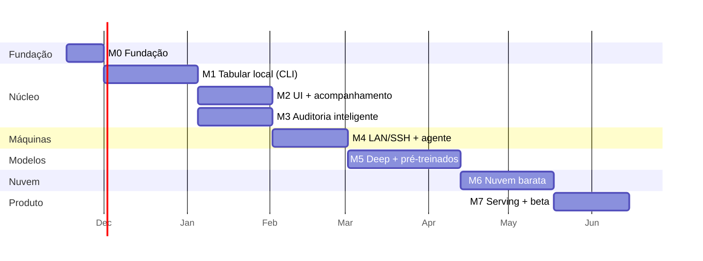

# Roadmap

Cada milestone entrega **algo usável de ponta a ponta**, não uma camada isolada.

> As datas são indicativas, assumindo 1 pessoa em tempo parcial com ajuda de IA. M2 e M3 podem andar em paralelo.

## M0: Fundação
**Entrega:** repositório estruturado, CI verde, contratos definidos.
- Workspace Cargo com os crates vazios e fronteiras definidas
- Pacote Python `tempera_worker` com `uv`
- CI (Rust + Python), `cargo deny`, pre-commit
- JSON Schema do `tempera.yaml`, `.proto` v1, formato JSONL de eventos
- ADRs 0001–0006 aceitos

## M1: Tabular local (CLI)
**Entrega:** `tempera run tempera.yaml` treina um modelo tabular **correto** na máquina local e gera um relatório.
- Ingestão CSV/Parquet → Parquet normalizado, com hash de conteúdo
- Profiling
- Auditoria estatística básica (A1, A2, A4, A5, A10)
- Splits (estratificado, grupo, temporal), com o teste tocado uma única vez
- Backends: nativo (linfa: linear, logística, árvore) e Python (sklearn, LightGBM, XGBoost)
- Baseline + candidatos + leaderboard
- Tracking em SQLite, relatório HTML
- Executor local + agente local (já com o protocolo gRPC real)

## M2: UI + acompanhamento
**Entrega:** a jornada inteira pelo navegador, com métricas ao vivo e ETA.
- Server Axum + WebSocket + UI SvelteKit embutida
- Telas: dados, objetivo, auditoria, estratégia, máquina, treino ao vivo, resultado
- ETA online (warm-up + EMA)
- Cancelar / parar e usar o melhor checkpoint
- HPO com ASHA; algoritmos M2 do catálogo (CatBoost, kNN, SVM, clusterização, séries temporais com GBM)

## M3: Auditoria inteligente
**Entrega:** auditoria completa, com o SLM local explicando e sugerindo.
- Checagens A3, A6, A7, A8, A9, A11, A12, A13
- Integração com Cleanlab e Fairlearn via worker
- Conselheiro SLM com mistral.rs (download e gestão de modelos, saída JSON validada)
- Benchmark de auditoria com problemas plantados (na CI)
- Benchmark de SLMs para classificação de colunas → escolha do padrão

## M4: LAN/SSH + agente remoto
**Entrega:** "use aquele PC com GPU da sala" funciona com 1 cadastro.
- `SshExecutor` (russh), bootstrap do agente com verificação de assinatura
- Inventário de hardware (NVML), telemetria de GPU
- Provisionamento de Python remoto com `uv` + cache
- Cache de dados por hash no worker
- Checkpoint/retomada genéricos
- Descoberta mDNS (opcional)

## M5: Deep learning + pré-treinados
**Entrega:** classificação de imagem/texto e fine-tune de LLM com LoRA, com recomendação entre "do zero" e "pré-treinado".
- Adaptadores PyTorch: visão (timm), texto (HF), LLM (PEFT/Unsloth)
- Backend nativo Burn (MLP, CNN pequena)
- Estimativa de memória (pesos, otimizador, ativações via profiling)
- Recomendador "do zero × pré-treinado" com justificativa
- Export ONNX/safetensors; bloqueio de pickle

## M6: Nuvem barata
**Entrega:** "rode no mais barato que termina em 2 h" com GPU alugada, sem sustos.
- Providers RunPod e Vast.ai
- Catálogo de preços sincronizado
- Estimativa de custo e recomendação de máquina
- Spot + retomada automática após preempção
- Teto de orçamento, desligamento automático, reaper de órfãs, conciliação de custo
- Relatório de "economia vs. execução ingênua"

## M7: Serving + beta
**Entrega:** produto instalável por terceiros.
- `tempera serve`: endpoint HTTP de inferência (ort/Candle)
- Modo servidor de time: auth e papéis
- Instalador (`cargo-dist`), documentação de usuário, exemplos
- Programa beta com 5–10 usuários reais por persona
- Decisão de licença e modelo de negócio
