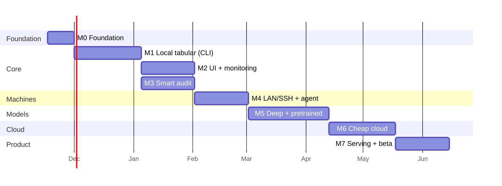

# Roadmap

Each milestone delivers **something usable end to end**, not an isolated layer.

> Dates are indicative, assuming 1 person part-time with AI assistance. M2 and M3 can proceed in parallel.

## M0: Foundation
**Delivers:** structured repository, green CI, defined contracts.
- Cargo workspace with empty crates and defined boundaries
- `tempera_worker` Python package with `uv`
- CI (Rust + Python), `cargo deny`, pre-commit
- `tempera.yaml` JSON Schema, `.proto` v1, JSONL event format
- ADRs 0001–0006 accepted

## M1: Local tabular (CLI)
**Delivers:** `tempera run tempera.yaml` trains a **correct** tabular model on the local machine and generates a report.
- CSV/Parquet ingestion → normalized Parquet, with content hashing
- Profiling
- Basic statistical audit (A1, A2, A4, A5, A10)
- Splits (stratified, group, temporal), with the test set touched only once
- Backends: native (linfa: linear, logistic, tree) and Python (sklearn, LightGBM, XGBoost)
- Baseline + candidates + leaderboard
- Tracking in SQLite, HTML report
- Local executor + local agent (already using the real gRPC protocol)

## M2: UI + monitoring
**Delivers:** the whole journey in the browser, with live metrics and ETA.
- Axum server + WebSocket + embedded SvelteKit UI
- Screens: data, objective, audit, strategy, machine, live training, result
- Online ETA (warm-up + EMA)
- Cancel / stop and use the best checkpoint
- HPO with ASHA; M2 algorithms from the catalog (CatBoost, kNN, SVM, clustering, time series with GBM)

## M3: Smart audit
**Delivers:** a complete audit, with the local SLM explaining and suggesting.
- Checks A3, A6, A7, A8, A9, A11, A12, A13
- Cleanlab and Fairlearn integration via the worker
- SLM advisor with mistral.rs (model download and management, validated JSON output)
- Audit benchmark with planted problems (in CI)
- SLM benchmark for column classification → choice of the default

## M4: LAN/SSH + remote agent
**Delivers:** "use that GPU PC in the living room" works with a single registration.
- `SshExecutor` (russh), agent bootstrap with signature verification
- Hardware inventory (NVML), GPU telemetry
- Remote Python provisioning with `uv` + caching
- Data caching by hash on the worker
- Generic checkpointing/resumption
- mDNS discovery (optional)

## M5: Deep learning + pretrained models
**Delivers:** image/text classification and LLM fine-tuning with LoRA, with a recommendation between "from scratch" and "pretrained".
- PyTorch adapters: vision (timm), text (HF), LLM (PEFT/Unsloth)
- Burn native backend (MLP, small CNN)
- Memory estimation (weights, optimizer, activations via profiling)
- "From scratch × pretrained" recommender with justification
- ONNX/safetensors export; pickle blocking

## M6: Cheap cloud
**Delivers:** "run on the cheapest option that finishes within 2 h" with a rented GPU, with no surprises.
- RunPod and Vast.ai providers
- Synced price catalog
- Cost estimation and machine recommendation
- Spot + automatic resumption after preemption
- Budget cap, auto-shutdown, orphan reaper, cost reconciliation
- "Savings vs. naive run" report

## M7: Serving + beta
**Delivers:** a product that third parties can install.
- `tempera serve`: HTTP inference endpoint (ort/Candle)
- Team server mode: auth and roles
- Installer (`cargo-dist`), user documentation, examples
- Beta program with 5–10 real users per persona
- License and business model decision
