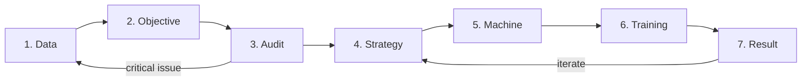

# User Journey

A guided flow in 7 steps. Each step also exists in the CLI (`tempera <command>`) and as a field in `tempera.yaml` (see [Contracts](Contracts.md)), for those who prefer code.

## 1. Data

- Upload or path: CSV, Parquet, JSONL, image folder (`class/file.jpg`), text folder, or a connection (Postgres, S3).
- The system converts everything to **Parquet/Arrow** and generates a **profile**: inferred types, nulls, cardinality, distributions, and samples.
- Data is versioned by content hash, so the same file is never processed twice.

## 2. Objective

- "What do you want to predict?": the user picks the target column, or the folder/label in the case of images and text.
- The system infers the task type (binary or multiclass classification, regression, time series, clustering, text generation) and the user confirms.
- A suggested primary metric (AUC, F1, RMSE, MAPE...), with an explanation of **why that** metric.
- Optional fields: time column, group column (e.g., `customer_id`), and sensitive attributes for fairness.

## 3. Audit (mandatory)

A traffic-light report:

- 🔴 **Blocking:** e.g., "the `chargeback_amount` column has a 0.99 correlation with the target and only exists after the event → leakage". Training is blocked until the user decides.
- 🟡 **Warning:** e.g., "the positive class is 3% → we will use a stratified split and the PR-AUC metric".
- 🟢 **OK**

The local SLM explains each item in natural language and suggests actions. The user accepts or rejects **each** suggestion, and the decision is recorded in the run. Details in [Data Audit](Data-Audit.md).

## 4. Strategy

- **Split:** stratified random, by group, or temporal, chosen based on what the audit found.
- **From scratch × pretrained:** a recommendation with a justification, which the user can override.
- **Algorithms:** the default mode is *"baseline + candidates"*: the cheapest baseline runs first and sets the bar.
- **Budget:** maximum time and maximum amount (US$).
- **Advanced mode:** manual hyperparameters and search (ASHA).

## 5. Machine

A comparison table generated for **this** job:

| Machine | Fits in memory? | ETA | Estimated cost | Note |
|---|---|---|---|---|
| This laptop (CPU) | ✅ | 4 min | US$ 0 | Recommended for the baseline |
| `living-room-pc` (RTX 3090, LAN) | ✅ | 40 s | US$ 0 | |
| RunPod RTX 4090 spot | ✅ | 30 s + 2 min boot | US$ 0.03 | |
| A100 80GB on-demand | ✅ | 25 s + 3 min boot | US$ 0.40 | Oversized |

The user picks one or leaves it on **"cheapest that finishes within X"**.

## 6. Training (monitoring)

- Progress bar with **ETA**, **accumulated cost**, and **projected cost**.
- Live curves: loss and validation metrics, plus GPU/CPU/memory usage.
- Streaming logs.
- Available actions: pause, cancel, or "stop and use the best checkpoint".
- Alerts: overfitting detected, exploding loss (NaN), budget at 80%.
- If a spot instance goes down, the job resumes on its own from the last checkpoint and notifies the UI.

## 7. Result

- **Leaderboard** of the candidates against the baseline.
- Model report: metrics on the test set (touched only once), confusion matrix, curves, feature importance, per-group fairness, and calibration.
- **Actual × estimated cost** and actual time × ETA.
- Export to ONNX/safetensors, with an inference snippet and an optional local endpoint (`tempera serve`).
- **"Reproduce"** button: the complete `tempera.yaml`, with the data hash and seed.
